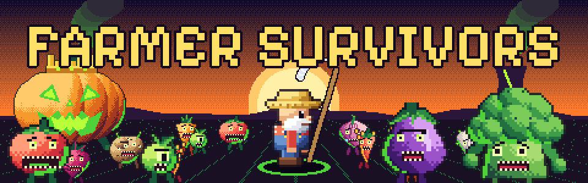
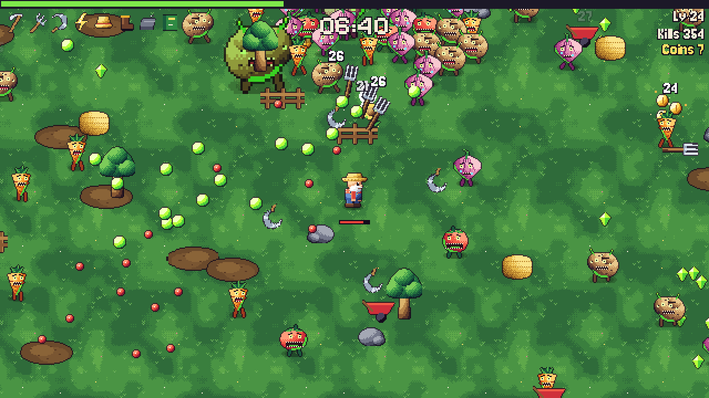
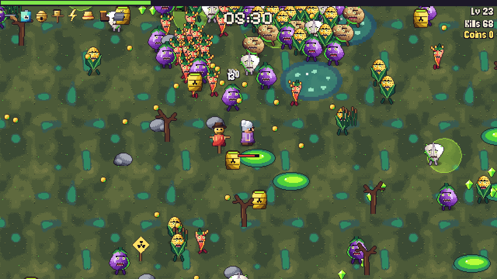
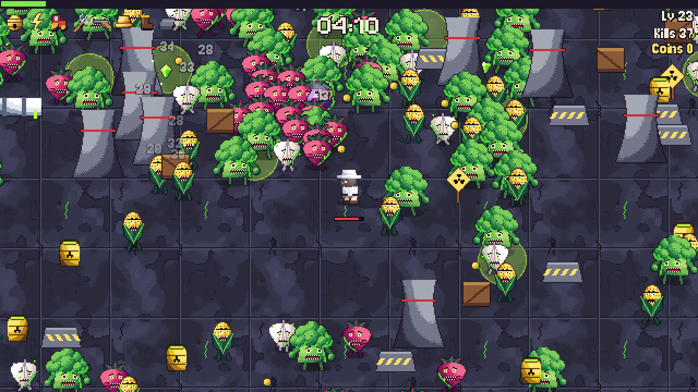
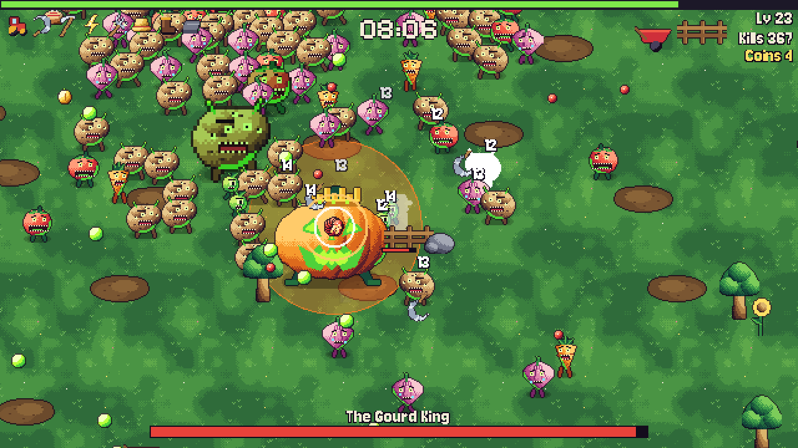
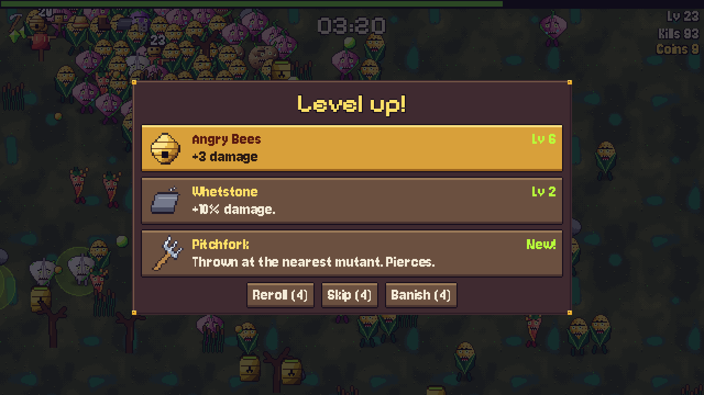
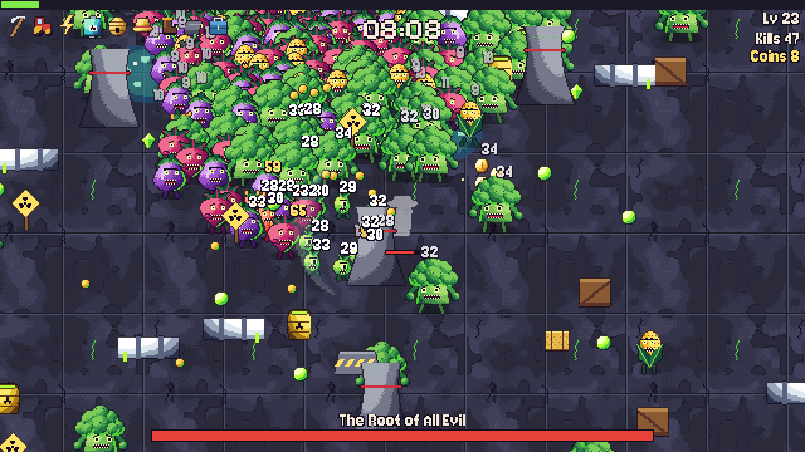
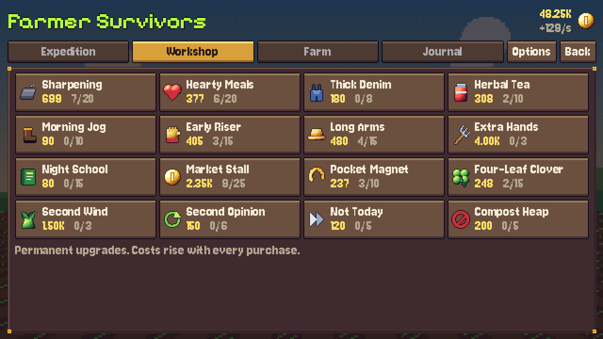
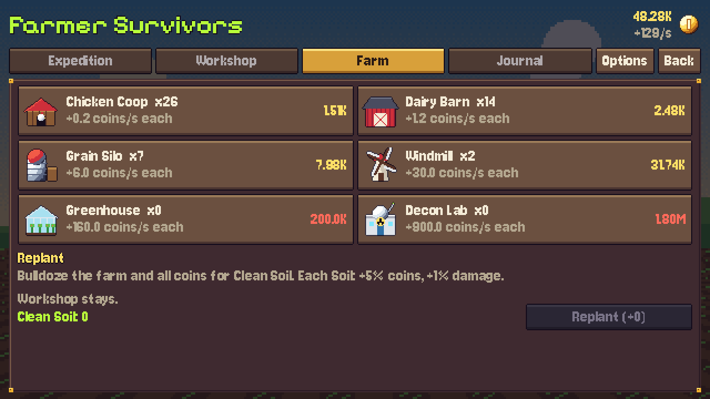

# Farmer Survivors

An incremental survivors-like made with Godot 4.7. A reactor leak has mutated the
crops of Green Hollow, and old Hank is taking up his scythe.

**[Play Farmer Survivors on itch.io](https://emilianostack.itch.io/farmer-survivors)**: free, in your browser or as a Windows download.

**Run locally:** run `build/FarmerSurvivors.exe`, or open this folder in Godot 4.7 and press F5.

**Controls:** WASD, arrow keys or gamepad to move. Weapons fire on their own.
Esc pauses. Enter, Space or mouse work in menus.

**Languages:** English (default), Português (Brasil), Español, Français. Switch in
Options. Text lives in `i18n/strings.csv`: add a column to add a language, then list it in
`Save.LANGUAGES` and in the project's translation settings.

## Screenshots

| | |
| --- | --- |
|  |  |
|  |  |
|  |  |
|  |  |

## Layout

| Path | What |
| --- | --- |
| `scripts/data/db.gd` | All balance and content: enemies, waves, weapons, upgrades, buildings |
| `scripts/autoload/` | Save and idle economy, audio |
| `scripts/game/` | Run loop, enemies and bosses, weapons, effects, HUD |
| `scripts/ui/` | Theme, farm hub, title, story, results, options |
| `tools/` | Generators for all art and audio (GDScript, no external tools) |
| `store/` | itch.io page assets: cover, banner, screenshots, description |

## Pickups

XP chests (green) grant one full level of experience and pull in every crystal on the map.
They appear on their own every 75-100 s, and giants, some elites and hay bales drop them.

## Regenerating assets

    godot --headless --path . --script res://tools/gen_sprites.gd
    godot --headless --path . --script res://tools/gen_audio.gd

## Exporting

    godot --headless --path . --export-release "Windows Desktop" build/FarmerSurvivors.exe
    godot --headless --path . --export-release "Web" build/web/index.html

Include the font and Godot licence notices with every release. The web build needs
`index.html` at the root of its zip.

## Tests

    godot --headless --path . -- --dev=eco                       # economy, prestige, save
    godot --headless --path . -- --dev=i18n                      # translation audit
    godot --headless --path . --fixed-fps 60 -- --dev=flow       # real input walkthrough
    godot --headless --path . --fixed-fps 60 -- --dev=bugs       # edge-case regressions
    godot --headless --path . --fixed-fps 60 -- --dev=chaos:1:10 # random stress: seed, rounds
    godot --headless --path . --fixed-fps 60 -- --dev=sim:0:0:hank:1:0   # bot plays a run
    bash tools/balance.sh "<godot>" 0:0:hank:0 1:0:rosa:6        # stage:rad:char:meta

## Credits

Made with [Godot](https://godotengine.org).
Fonts under the SIL Open Font License (see `assets/fonts/`): Pixelify Sans, Jersey 10.
